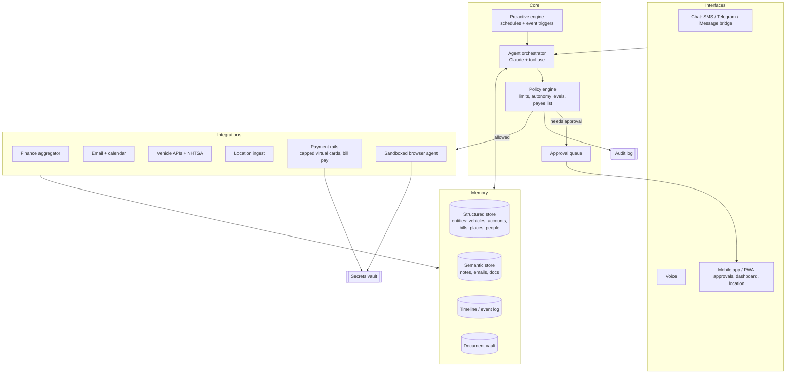

# Personal AI Assistant — Scope

**Status:** Draft v0.1 · **Date:** 2026-10-29

---

## 1. Vision

One assistant that **knows my life** (people, vehicles, accounts, places, routines, work, preferences) and **acts on my behalf** (pays bills, books appointments, handles renewals, answers questions), with autonomy that grows as it proves it can be trusted.

You should be able to say things like:

- "When is the registration due on the truck, and can you renew it?"
- "Did the electric bill go up this month? Pay it if it looks normal."
- "Book an oil change for the Tahoe somewhere near where I'll be Thursday."
- "Pay Meinecke $30 for the haircut." (It knows Meinecke is your barber, that you pay him by Venmo, and his handle.)
- "What did I spend on fuel last quarter?"
- "Remind me to call Mike when I'm leaving the office."

### Design principles

1. **Context first, actions second.** An assistant that knows everything but can't act is still useful. One that acts without context is dangerous. Build the memory first.
2. **Money limits are enforced outside the AI.** The model never decides how much it's allowed to spend. Hard caps live in the payment instrument (capped virtual cards, bank limits) and in a policy engine written in code, not in a prompt.
3. **Autonomy is earned per action type.** Every action starts at "ask me first" and moves up only when I promote it.
4. **Everything is auditable and editable.** I can see what it knows and where each fact came from, and correct it. Every action it takes is logged.
5. **Outside content can't give it orders.** Emails, web pages, PDFs and texts are data. "Pay this invoice" in an email never triggers a payment on its own.

---

## 2. Capability map

Each area lists what the assistant **knows** (context) and **does** (actions), plus the realistic data source.

### 2.1 Personal profile and memory (the core)

| Knows | Source |
|---|---|
| Identity, family, key contacts and relationships | Onboarding interview, contacts, email |
| Work: role, business, clients, recurring commitments | Onboarding, calendar, email |
| Preferences (vendors, brands, times, communication style) | Learned from conversations, confirmed by me |
| Important documents (license, insurance cards, titles, policies) | Uploaded docs + OCR |

**Does:** answers questions about my life, fills forms, keeps facts current, notices contradictions ("You said the Silverado was sold, but insurance still lists it").

### 2.2 Vehicles

| Knows | Source |
|---|---|
| Year/make/model/trim, VIN, plate | Onboarding + VIN decode (NHTSA vPIC API, free) |
| Registration and inspection due dates | Docs / DMV notices in email |
| Insurance policy, carrier, renewal date, coverage | Policy docs, carrier emails |
| Loan or lease: lender, payment, payoff | Bank data, statements |
| Mileage, fuel level, location, maintenance due | Connected-car API (e.g. Smartcar, OEM apps) where supported, otherwise fuel and service receipts |
| Open recalls | NHTSA recalls API (free) |
| Service history | Receipts, shop emails |

**Does:** reminds about renewals and maintenance, checks recalls, books service, renews registration online (browser agent, with approval), tracks cost of ownership per vehicle.

### 2.3 Bills and finances

| Knows | Source |
|---|---|
| Accounts, balances, transactions | Aggregator: Plaid (business-grade) or SimpleFIN / Teller (personal-friendly, read-only) |
| Recurring bills: payee, typical amount, due date, autopay status | Derived from transactions + bill emails |
| Subscriptions | Derived from transactions |
| Unusual charges or price changes | Anomaly detection vs. history |

**Does:** makes sure nothing is missed, flags anomalies, pays bills (see §5 for how), cancels unwanted subscriptions, answers spending questions, prepares tax-relevant summaries.

#### Paying people (Venmo, Zelle, Cash App, PayPal)

"Pay Meinecke $30 for haircut" needs four things the assistant has to know or work out:

| Step | What it resolves | How it knows |
|---|---|---|
| **Who** | "Meinecke" → the person you mean | Contacts + memory. Uses context to pick the right one: "haircut" means your barber, not the Meineke car shop. Asks if it's still unsure. |
| **How** | You pay this person by Venmo | Learned from past payments (Venmo receipt emails, bank transactions) or told once and remembered |
| **Where** | Their Venmo handle | Taken only from a past successful payment or from you directly, never from a text or email (see §3) |
| **What's normal** | Usually $30, note "haircut", about every 3 weeks | Payment history |

Then it makes the payment the safest way that payment app allows (see §5.1), confirms it went through, and logs it.

### 2.4 Places, routines and location

| Knows | Source |
|---|---|
| Home, work, frequent places (gym, fuel stops, customers) | Location history clustered into "places" |
| Typical schedule and commute | Location + calendar |
| Where I am now (when I allow it) | Phone location stream |

Note: Google Maps Timeline moved to on-device storage and no longer has a usable cloud history, so **location has to be collected by us**: a small companion app, or an existing open-source tracker like OwnTracks or the Home Assistant companion app that posts to our server.

**Does:** location-based reminders ("when I leave work"), plans errands along existing routes, suggests appointment times and places that fit my routine, logs mileage.

### 2.5 Calendar, email and communications

| Knows | Source |
|---|---|
| Schedule, commitments, travel | Google / Microsoft calendar APIs |
| Inbox: bills, receipts, confirmations, notices | Gmail / Outlook APIs |
| Who matters and how I talk to them | Email + contacts |

**Does:** daily brief, schedules and reschedules, drafts replies (sends only with approval at first), files receipts and documents automatically.

### 2.6 Errands and long-tail tasks

Booking appointments, ordering, renewals, filling web forms, calling businesses.

- **APIs first** where they exist (calendar, payments, some booking platforms).
- **Browser agent** (sandboxed, headless browser driven by the model) for everything else: DMV renewals, utility portals, booking sites.
- **Phone calls** (later phase): voice agent for simple calls like scheduling or checking hours, always disclosed as an assistant.

### 2.7 Out of scope for v1 (revisit later)

Health and medical records · investing and trading · tax filing · smart-home control · acting for other family members · business operations at scale (dispatch, payroll, fleet management).

---

## 3. Autonomy model

Every action type has a level. Everything starts at L1 or L2. I promote action types over time.

| Level | Meaning | Example |
|---|---|---|
| **L0 — Inform** | Tells me, does nothing | "Your registration expires in 30 days." |
| **L1 — Prepare** | Does all the work, I execute | Fills the renewal form, sends me the link |
| **L2 — Approve** | Asks, then acts on one tap | "Pay $142.18 to Duke Energy? ✅ / ❌" |
| **L3 — Act within limits** | Acts, tells me after | Pays known utility bills ≤ 120% of the 6-month average |
| **L4 — Autonomous** | Acts, shows up in the weekly digest | Files receipts, updates memory, renews subscriptions I've whitelisted |

**Policy rules (code, not prompt):**

- Payee must be on the **known payee list**. New payees always require L2 approval and are verified against a source I control (prior statements), never just an email.
- **Person-to-person payments can't be reversed**, so they stay at L2 by default. A payment handle (Venmo, Cash App, PayPal, Zelle phone or email) is trusted only if a past payment to it succeeded or I entered it myself. If anyone says "I have a new Venmo", the assistant asks me before paying it.
- Per-transaction, per-day and per-month spend caps.
- Amount anomaly (for example more than 20% above typical) → drop back to L2.
- Anything irreversible (sending to a new contact, cancelling insurance, wire transfers) → always L2 or higher.
- Kill switch: one command pauses all actions.

---

## 4. Architecture



### 4.1 Components

**Interfaces**
- **Chat** is the main interface. Telegram is the easiest to build on. SMS via Twilio works everywhere. iMessage needs a Mac bridge and is fragile.
- **Companion app / PWA** handles push-notification approvals, the "what I know about you" page, the action log, and location reporting.
- **Voice** (later): phone number you can call, or a voice mode in the app.

**Agent orchestrator**
- Claude via the Claude Agent SDK / API with tool use. Tools exposed as MCP servers so each integration is a separate, testable module.
- System context holds a compact **profile summary**. Detailed facts are retrieved on demand.
- Integrations and their tools are grouped by risk class (read / write / money), which the policy engine uses.

**Memory** (the most important part to get right)
- **Structured entities** in Postgres: `Person`, `Vehicle`, `Account`, `Bill`, `Payee`, `Place`, `Document`, `Routine`, `Preference`. Typed, queryable, and exact.
- **Semantic store** (pgvector) for unstructured content: email bodies, notes, document text.
- **Timeline**: append-only event log (trips, payments, appointments, conversations).
- **Every fact carries provenance**: source, timestamp, confidence, and whether I confirmed it. Low-confidence facts get confirmed in conversation before they're relied on.
- **Memory write pipeline**: after each conversation or ingested email, an extraction pass proposes fact updates. High-confidence ones are applied, others are queued for confirmation.

**Proactive engine**
- Scheduled jobs: daily brief, bill-due scans, renewal checks, recall checks, weekly digest.
- Event triggers: new email from a biller, new transaction, arriving at or leaving a place, calendar changes.

**Action layer**
- Prefer official APIs. Fall back to the browser agent in a sandboxed container with per-site credentials pulled from the vault at run time. The model never sees raw passwords.
- Every action goes through the policy engine and lands in the audit log, including screenshots for browser actions.

**Security**
- Secrets in a real vault (1Password Service Accounts, or cloud KMS-backed secrets). Encrypted database. MFA on everything.
- **Prompt-injection defense**: content from email and the web is tagged untrusted. Untrusted content can inform but can't authorize. Payment and new-recipient tools require the payee to match the known payee list.
- Single-tenant: it's your data, on infrastructure you control.

### 4.2 Suggested stack

| Layer | Choice | Why |
|---|---|---|
| Language | TypeScript (or Python) | Good SDKs for Claude, Plaid, Google, Playwright |
| Agent | Claude Agent SDK + MCP tool servers | Tool use, subagents, browser and computer use |
| Database | Postgres + pgvector | One store for structured data and embeddings |
| Jobs | Postgres-backed queue + cron (Temporal if it grows) | Keeps it simple at first |
| Chat | Telegram bot first, Twilio SMS second | Fastest path |
| App | PWA (Next.js) | Push approvals, no app store needed |
| Location | OwnTracks or Home Assistant app → HTTPS endpoint | Already built, works on iOS and Android |
| Browser agent | Playwright in an isolated container | Mature, scriptable, screenshots for the audit log |
| Secrets | 1Password Service Accounts | Good SDK, you probably already use a password manager |
| Hosting | Single small cloud VM or Fly.io, daily encrypted backups | Low cost, single tenant |

---

## 5. Paying bills (the hardest part)

There is **no consumer API to drive your bank's bill pay**, and scripting a bank's website is fragile and usually breaks its terms of service. So bill payment is layered:

| Tier | Mechanism | Covers | Risk |
|---|---|---|---|
| **1. Autopay, supervised** | Billers' own autopay. The assistant checks it's on, watches each amount, and alerts or stops on anomalies | Most recurring bills (utilities, phone, insurance, loans, cards) | Lowest |
| **2. Capped virtual cards** | Merchant-locked virtual cards with spend limits (e.g. Privacy.com, or issuer virtual cards). The browser agent pays on the biller's portal | Bills without autopay, one-off payments, renewals (DMV, tolls) | **Hard cap enforced by the card, not the AI** |
| **3. Bank-to-biller APIs** | Debt-payment APIs (e.g. Method Financial) or ACH via Plaid Transfer | Credit cards, loans; more of a business setup | Medium; needs approval flow |
| **4. Prepared for me** | Assistant fills everything in, I tap pay in my bank app | Anything else | None |

**Recommendation:** Start with tier 1 + tier 4 (phase 1), add tier 2 (phase 3). Treat tier 3 as optional.

The monthly bill workflow:

1. Detect the bill (email, portal, or recurring transaction pattern).
2. Match to a known payee and compare to history.
3. Autopay on and amount normal → log it, mention it in the digest.
4. Not on autopay → pay per the autonomy level for that payee.
5. Confirm it cleared (transaction appears) → update the timeline.

### 5.1 Paying people (Venmo and similar)

**The constraint:** Venmo retired its own developer and payouts APIs for new developers. Zelle and Apple Cash have no consumer APIs. Cash App has no public API for sending money between people. So "pay Meinecke from *your* Venmo" can't be a fully hands-off API call.

| Option | How it works | Your effort | Verdict |
|---|---|---|---|
| **A. Prefilled payment** (recommended) | The assistant sends a link that opens Venmo with Meinecke's handle, $30 and "Haircut" already filled in. You check it and tap **Pay**. Cash App (`cash.app/$tag/30`) and PayPal (`paypal.me/name/30`) links work the same way. | One or two taps | Uses Venmo's official payment links. Money comes from your own Venmo. You see exactly what's being sent. |
| **B. PayPal Payouts to a Venmo handle** | PayPal's Payouts API can send to a Venmo handle (US only). The money comes from a **PayPal Business** balance you top up. | None after setup | Truly hands-free, and the balance you top up is a hard cap. Downsides: needs a PayPal Business account, payments show as coming from the business, there are fees, and it mixes personal and business money. Check current eligibility with PayPal first. |
| **C. Automate the Venmo app or website** | A browser or phone-control agent logs into your Venmo and taps through | None | **Not recommended.** Likely breaks Venmo's terms, trips fraud checks and 2FA, and can get your account frozen. |
| **D. Zelle through your bank** | No API. Prepare the details; you send in your bank app. | A few taps | Fallback for people who only take Zelle. |

**Flow for "Pay Meinecke $30 for haircut" (option A):**

1. Work out who Meinecke is, his method (Venmo) and his verified handle from memory.
2. Check the policy: known handle, amount close to his usual $30.
3. Reply: *"Venmo $30 to @Meinecke-Barber, note 'Haircut'? [Open in Venmo]"*. One tap opens Venmo prefilled, a second tap pays.
4. Watch for Venmo's "You paid…" receipt email to confirm it went through, then log it to the timeline.
5. If no receipt shows up within an hour, remind me once.

Later, if you set up option B, a payment like this (verified handle, normal amount) can move to L3 and happen with no taps at all.

---

## 6. Phased roadmap

Estimates assume one developer working with AI coding help, part-time.

### Phase 0 — Foundations (2–3 weeks)
- Repo, infra, database schema, secrets vault, audit log.
- Telegram chat + Claude orchestrator.
- Onboarding interview that fills the profile (people, vehicles, work, accounts, places).
- "What I know about you" page (view and edit facts).
- **Done when:** I can ask "What cars do I have and when is each registration due?" and get correct answers.

### Phase 1 — Awareness (3–4 weeks)
- Gmail + Calendar read access. Ingest bills, receipts and notices.
- Finance aggregator (read-only). Detect recurring bills and subscriptions.
- VIN decode, recall checks, renewal tracking.
- Daily brief + reminders. Bill-due alerts (tier 1 and 4 payments).
- **Done when:** a month passes with no missed bill or renewal, and I didn't have to tell it about any of them.

### Phase 2 — Places and routines (2–3 weeks)
- Location ingest. Place clustering (home, work, frequent stops).
- Location-triggered reminders. Mileage log per vehicle.
- Routine model (typical week) used for scheduling suggestions.
- **Done when:** "Remind me when I leave work" works, and it can tell me where I usually fuel up.

### Phase 3 — Actions with approval (4–6 weeks)
- Approval queue + push notifications in the PWA.
- Capped virtual cards + browser agent for paying bills and renewals.
- Paying people: "Pay Meinecke $30" → prefilled Venmo, Cash App or PayPal link, confirmed from the receipt email (§5.1 option A).
- Calendar writes, email drafts and sends (with approval).
- Booking appointments (service shops, etc.) via APIs or browser.
- **Done when:** I approve a bill payment and a car service booking from my phone in one tap each, and "Pay Meinecke $30 for haircut" takes me two taps.

### Phase 4 — Earned autonomy (ongoing)
- Per-action autonomy promotion (L2 → L3 → L4) with limits.
- Weekly digest of everything done.
- Optional: hands-free payments to people via PayPal Payouts (§5.1 option B).
- Voice interface. Simple outbound phone calls.
- **Done when:** most routine admin happens without me, and the weekly digest is the main thing I read.

**Rough total to a strong v1 (phases 0–3): ~3–4 months part-time.**

---

## 7. Running costs (rough, monthly)

| Item | Estimate |
|---|---|
| LLM usage (chat + background jobs) | $20–100, depending on volume and model mix |
| Hosting (VM + Postgres + backups) | $10–40 |
| Finance aggregator | SimpleFIN ~$15/year · Plaid varies by product and volume |
| Connected-car API | Free tier to low tens of dollars, depending on provider and vehicle count |
| SMS / voice (if used) | $5–20 |
| **Total** | **~$50–200/month** |

Verify pricing for each provider before committing; these change often.

---

## 8. Risks and mitigations

| Risk | Mitigation |
|---|---|
| Wrong or fraudulent payment | Known-payee list, card-level caps, anomaly checks, approvals, kill switch |
| Paying the wrong person (lookalike handles, "my Venmo changed" scams) | Handles trusted only from past successful payments or my own input; changed handles always need my approval; I always see the handle before I tap Pay |
| Prompt injection (malicious email or web page) | Untrusted-content tagging; money tools require verified payees; no auto-action on email instructions |
| Data breach (this system holds everything) | Single tenant, encryption, vault for secrets, MFA, minimal retention of raw data, no secrets in model context |
| Wrong facts in memory | Provenance + confidence on every fact, confirmation for low-confidence facts, editable memory |
| Browser automation breaks or violates terms | APIs first; browser only for portals that allow it; screenshots + failure alerts; never script bank logins |
| Over-reliance (silent failures) | Weekly digest, "things I couldn't do" alerts, health checks on every integration |
| Integration sprawl | Each integration is its own MCP module with tests; add only when a real task needs it |

---

## 9. Build vs. buy

| Option | Effort | Fit |
|---|---|---|
| **Off-the-shelf assistant + connectors** (Claude with memory + Gmail/Calendar connectors, a budgeting app) | Days | Good for context and Q&A, weak on proactive work and payments |
| **Custom build on Claude Agent SDK** (this document) | ~3–4 months part-time | Full control, deep personal context, safe action-taking |
| **Hybrid** — start with off-the-shelf for Q&A while building phases 0–1 | — | **Recommended**: get value now, build the parts nothing off the shelf does well (memory model, bills, vehicles, policy engine) |

---

## 10. Open questions (need your input)

1. **Phone:** iPhone or Android? (Affects location, notifications, iMessage.)
2. **Main interface:** Text/SMS, Telegram, iMessage, voice, or an app?
3. **Personal vs. business:** Should it cover your work and business (email, vehicles, bills), or keep strictly personal with business later?
4. **Who else:** Just you, or family members too (shared vehicles, household bills)?
5. **Money comfort level:** Is "one-tap approve every payment" acceptable at first? What's a per-payment amount you'd be fine with it paying on its own later?
6. **Banks and billers:** Which banks, cards, utilities, insurance and lenders? (Determines which integrations are actually available.)
7. **Vehicles:** Makes and model years? (Determines connected-car API coverage.)
8. **Hosting:** Cloud VM, or a machine at home?
9. **Paying people:** Which apps do you use (Venmo, Zelle, Cash App, PayPal, Apple Cash)? Is "two taps to confirm" fine, or do you want the hands-free PayPal Business setup?
10. **Build:** Are you building this yourself (with Claude Code), hiring, or a mix?

---

## Appendix A — Core data model (first cut)

```
Person      (id, name, aliases, relationship, role, contact_methods,
             default_payment_handle_id, notes)
PaymentHandle (id, person_id, app [venmo|zelle|cashapp|paypal|applecash],
             handle, verified, verification_source, first_paid_at,
             last_paid_at, typical_amount, typical_note)
Vehicle     (id, vin, year, make, model, trim, plate, state, owner_id,
             registration_due, inspection_due, insurance_policy_id,
             loan_account_id, odometer, odometer_as_of)
Account     (id, institution, type, mask, aggregator_ref, owner_id)
Payee       (id, name, category, verified, verification_source,
             payment_methods, portal_url, autopay_enabled)
Bill        (id, payee_id, amount, due_date, status, source, paid_txn_id)
Place       (id, label, lat, lng, radius, category, visit_stats)
Routine     (id, description, pattern, places, confidence)
Document    (id, type, entity_ref, expires_at, file_ref, extracted_fields)
Preference  (id, domain, key, value, source, confirmed)
Fact        (id, subject_ref, predicate, value, source, confidence,
             confirmed, valid_from, valid_to)
Action      (id, type, autonomy_level, status, request, result,
             approved_by, approved_at, audit_refs)
```

## Appendix B — Example proactive jobs

| Job | Schedule | Output |
|---|---|---|
| Daily brief | 6:30am | Calendar, bills due, reminders, weather on routes |
| Bill scan | Daily | New bills, anomalies, upcoming due dates |
| Renewal check | Weekly | Registration, insurance, licenses, domains, IDs expiring within 60 days |
| Recall check | Monthly | Open recalls per VIN |
| Subscription review | Monthly | New, increased, or unused subscriptions |
| Weekly digest | Sunday evening | Everything done, everything pending, anything it couldn't do |
