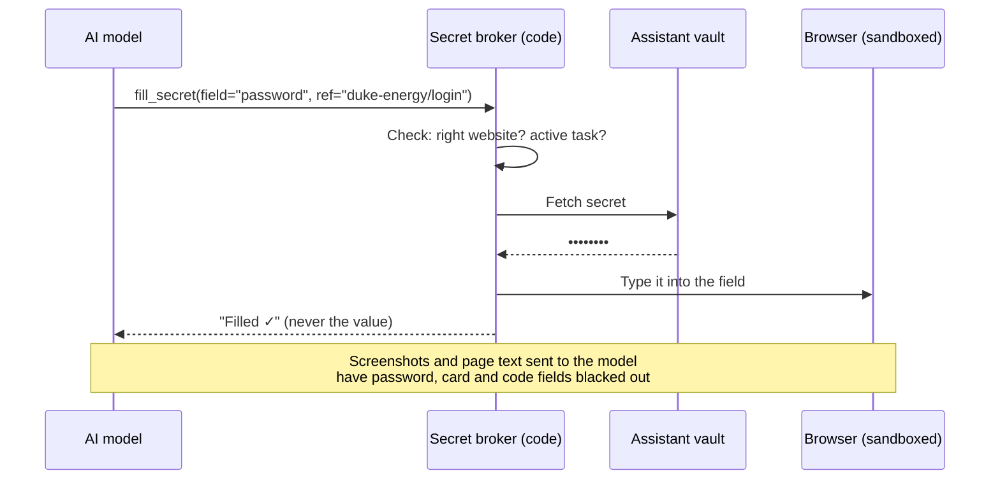

# Sensitive Credentials and Data — Design

**Status:** Draft v0.2 · **Date:** 2026-10-29 · Part of [SCOPE.md](SCOPE.md)

---

## 1. Goal

**You name any bill website, and from then on the assistant logs in by itself with saved credentials**, checks the balance, downloads the statement and pays, with no prompts at login time.

It does this **without the AI model ever seeing a password, card number or code**. Saved logins only work on the sites they belong to, and every use is logged.

## 2. The core rule: the model handles references, never secrets

The AI decides *what* to do. A small, separate program (the **secret broker**, ordinary code with no AI in it) does the sensitive part.

The model only ever sees names like `duke-energy/login` or `SSN on file (•••• 1234)`. Even if the model is tricked by a malicious email or web page, it has nothing to leak.

---

## 3. How the assistant gets into each kind of account

| Tier | How | Examples |
|---|---|---|
| **A. Token, no password** | You sign in once on the provider's own screen. The assistant gets a token you can revoke anytime. | **Amex** card and checking (via Plaid), email, calendar |
| **B. Saved login, hands-free** (the main path for bill sites) | You add the login once (§5). After that the broker logs in by itself, on that site only. | **Any bill site you name:** utilities, phone, internet, insurance, DMV, tolls, loans, auto shops, subscriptions |
| **C. Asked each time** | Secure Entry (§5) with Face ID, nothing saved | Sites you'd rather not save, one-offs |
| **D. Never given to the assistant** | — | **Amex login**, **Apple ID**, main email passwords, **Venmo / PayPal logins**, recovery codes |

**Why tier D still exists:** those accounts can reset or drain everything else, and the assistant doesn't need their passwords anyway. It reads Amex through Plaid, reads email through tokens, and pays people with prefilled Venmo or PayPal links. If you later want a specific site moved out of tier D, it's a deliberate change you make, not the default.

---

## 4. Where saved logins live

### 4.1 Why not read Apple Passwords directly?

Apple doesn't let any other program read Apple Passwords / iCloud Keychain. Even on your own Mac, only Apple's apps can fill from it, and only after Touch ID or your password. Sharing a password group with an assistant Apple ID doesn't help either: the items sync, but nothing can read them programmatically. Working around this would mean unofficial hacks that break with macOS updates.

**So Apple Passwords stays your source of truth, and the assistant keeps its own copy of only the logins you add.** If the assistant vault is ever lost, nothing is lost: you just add the logins again from Apple Passwords.

### 4.2 The assistant vault

| Option | What it is | Pros | Cons |
|---|---|---|---|
| **1. macOS Keychain on your Mac** (recommended to start) | Logins stored in the Keychain of the "Assistant" macOS user, encrypted by macOS, read only by the broker | Free, no new account, never leaves your Mac | Add and edit only through the assistant (§5); tied to that Mac |
| **2. 1Password vault** | A dedicated "Assistant" vault read through a read-only service account | Nice app for viewing and editing logins on your phone, built-in authenticator codes, works if the system moves to a cloud server later | ~$3–5/month, another account to manage |

Option 1 fits the Mac-based setup. Switching to option 2 later is a migration script, and nothing else changes.

**The assistant's own keys** (Plaid keys, AI API key) live in the same Keychain, separate from your Apple Passwords. The AI model never sees them.

---

## 5. Adding a site: one time, from Apple Passwords

You text the assistant: *"Add my Duke Energy account."*

1. The assistant replies with a **Secure Entry** link: *"Add Duke Energy (duke-energy.com) login. [Add securely]"*
2. The link opens a private page in the assistant's web app. **Face ID** (passkey) is required to open it.
3. Tap the username field → **Passwords** → pick Duke Energy → Face ID fills in the username and password from Apple Passwords. (iOS won't suggest it on its own, because the page isn't on duke-energy.com.)
4. Confirm the site address. The login will only ever be used on `duke-energy.com`.
5. The login is **encrypted on your phone** so only the broker on your Mac can read it, then saved to the assistant vault.
6. The assistant does a **test login right away** and confirms: *"Duke Energy saved. Balance $142.18, due Nov 12, autopay is off."*

**After that, it's hands-free.** The assistant logs in whenever it needs to: scheduled bill checks, statement downloads, payments.

**Adding many at once:** text *"Add these: Duke Energy, Verizon, State Farm, SunPass"*. You get one Secure Entry page with a row per site and fill each from Apple Passwords. Better still, after bill discovery from your Amex history (SCOPE §2.3), the assistant offers *"Want to add logins for these 14 billers?"*

**When a password changes:** the login fails, and the assistant texts *"Duke Energy login failed. Password changed? [Update securely]"*. It never retries until the account locks.

**Passkey-only sites** can't be saved this way, because a passkey only works on its own website on your own device. Most bill sites still offer a password; if not, that site stays tier C.

**Never send passwords or codes in iMessage or WhatsApp.** Chat passes through the AI model and gets stored. If you do it by accident, the assistant redacts it from its memory and tells you to change that password.

---

## 6. Verification codes (2FA), hands-free where possible

Saved passwords aren't enough if the site texts a code. The Mac makes most of these hands-free too:

| Where the code arrives | How it's handled | Your effort |
|---|---|---|
| **Text message** | Turn on **Text Message Forwarding** to the Mac (iPhone → Settings → Apps → Messages). Codes then show up in Messages on the Mac too. When the broker triggers a login, it asks a small local reader for **only a code, only from that site's sender, only within the next 2 minutes**, and types it in. | None |
| **Email** | The broker reads the code directly from your inbox (same narrow rules) and types it in | None |
| **Authenticator app** | When you add the site, also add its authenticator setup key. The broker generates the codes. | None |
| **Push approval / phone call** | The assistant waits for you to approve | One tap |

To keep 2FA rare in the first place:

- **Saved browser sessions:** one encrypted browser profile per site, so the site stays logged in.
- **"Remember this device"** is ticked on every site that offers it.
- The browser always runs from the same Mac and home connection, so sites recognize it.

The AI model never sees any code. The code reader only answers the broker's narrow requests and can't be used to browse your messages.

---

## 7. Payment cards and Apple Pay

**Apple Pay** needs your Face ID on your own device, so it can't be automated and shouldn't be. When a site takes Apple Pay, the assistant gets everything ready and sends you the link to finish.

**A card the assistant can use itself** (for bills and renewals that don't take Apple Pay):

| Option | Hard spending cap? | Notes |
|---|---|---|
| **1. Virtual card service funded from Amex Rewards Checking** (e.g. Privacy.com) | ✅ Per card, locked to one merchant | Best protection: a stolen number only works at one merchant, up to its limit. **To verify:** whether the service accepts Amex Rewards Checking as a funding account. |
| **2. Amex Additional Card with a spending limit** | ✅ Monthly limit, as low as $200, set in the Amex app | Must be issued to a person (13 or older), and you're liable even above the limit. |
| **3. Your regular Amex number** | ❌ | Only with instant Amex alerts + broker policy limits. Not recommended for anything automatic. |

**Recommendation:** option 1 if the funding check works, otherwise option 2.

**Payment methods already saved on bill sites:** many bill sites already have your Amex card or checking account stored. Paying with what's on file needs no card entry at all, so it's often the simplest path. These payments still go through the autonomy policy (SCOPE §3): approval at first, automatic within limits later.

Either way:

- Card numbers live **only in the assistant vault** and are typed in by the broker. They are never stored in the database or shown to the AI model.
- **Every charge is reconciled.** Each payment the assistant makes is matched against Amex transactions from Plaid. Any charge it didn't make, on its own card, gets an immediate alert.

---

## 8. Broker guardrails (code, not prompts)

1. **Site binding:** each login works only on the site(s) it was saved for. A lookalike domain (`duke-energy-billing.com`) is refused and triggers an alert. This is how password managers stop phishing, and it also stops prompt injection.
2. **Task binding:** a login is released only for a task that you or a scheduled job started, never because a web page or email asked for it.
3. **Adding is the approval:** saving a login through Secure Entry approves hands-free use on that site. Paying is a separate step that follows the autonomy policy. High-sensitivity data (§9) needs Face ID every time.
4. **Masking:** password, card and code fields are blacked out in anything sent to the model. Outgoing text is scanned for anything that looks like a secret.
5. **Short-lived:** secrets are held in memory for seconds and never logged.
6. **Audit:** every login is logged (which site, which task, when, success or failure) and listed in the weekly digest. Unusual activity, like many logins in a short time, pauses the broker and alerts you.
7. **Kill switch:** one command locks the assistant vault, clears saved browser sessions and pauses all actions.

---

## 9. Sensitive personal data (not passwords)

| Sensitivity | Examples | Storage | What the AI model sees |
|---|---|---|---|
| **Low** | Address, VIN, plate, vehicle details | Normal memory | Everything |
| **Medium** | Driver's license number, date of birth, insurance policy numbers, utility account numbers | Encrypted field | Masked unless it's needed to answer you |
| **High** | SSN, passport number | Assistant vault only. The broker types it into forms after Face ID approval each time. | "SSN on file (•••• 1234)" |

---

## 10. Examples

### "Pay the electric bill"

1. The broker logs in to duke-energy.com with the saved login. The site texts a code; it shows up on the Mac and the broker types it in. The model sees "Logged in ✓".
2. The assistant reads the bill: $142.18, due Nov 12. That's within 5% of the usual amount.
3. Duke Energy is a known payee and the amount is normal, so per your autonomy setting it either:
   - **asks:** *"Pay Duke Energy $142.18 with the Amex on file? [Approve with Face ID]"*, or
   - **just pays** (once you've promoted utilities to "act within limits") and tells you after.
4. Confirmation screenshot saved. The payment is matched against the Amex transaction when it posts.

**What you did:** nothing, or one Face ID.

### "Renew the registration on the truck"

1. The broker logs in to the DMV site with the saved login. Session or 2FA handled as above.
2. The form needs your license number → the broker types it (medium sensitivity, masked to the model).
3. Payment → *"Pay $86.50 to the DMV for the truck's registration? [Approve with Face ID]"* → the broker types the assistant's card number.
4. Confirmation saved. Registration due date updated in memory. The charge is reconciled.

**What you did:** one Face ID. The AI model never saw a password, code, license number or card number.

---

## 11. Build plan

| Phase | Credential work |
|---|---|
| **0 — Foundations** | Broker skeleton, assistant vault in the Mac Keychain, encrypted per-site browser profiles, audit log, masking of model inputs and outputs, kill switch |
| **1 — Awareness** | Tier A connections: Amex via Plaid, email accounts, calendar |
| **2 — Saved logins** (moved earlier, since this is a core need) | Secure Entry page (passkeys, on-device encryption), "add a site" flow with test login, broker logging in through the browser, site and task binding, text-code reader on the Mac, email-code reader, authenticator codes, reading balances and due dates from bill sites |
| **3 — Actions** | Paying bills on bill sites (card on file or the assistant's card), the assistant's capped card setup, charge reconciliation |

## 12. Open questions

1. ~~**Password manager:**~~ Apple Passwords stays the source. The assistant keeps copies of only the logins you add. **Assistant vault:** Mac Keychain (free) or 1Password (~$3–5/month, nicer to manage)?
2. Would you set up a **virtual card service** (option 1) or an **Amex Additional Card** (option 2) for the assistant, or start with cards already saved on each bill site?
3. Do you have a **separate business Amex** or bank account that should stay out of scope (or be handled separately)?
4. Is it OK to turn on **Text Message Forwarding** to the Mac so text-message codes can be handled hands-free?
