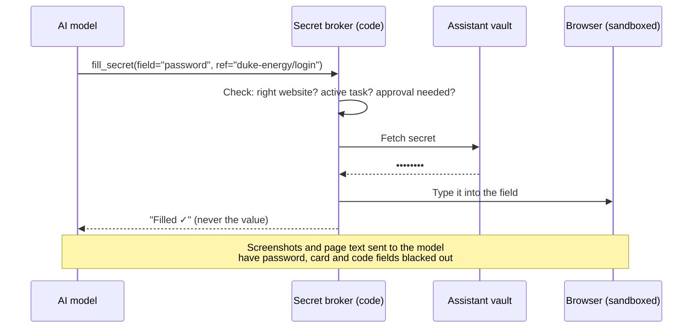

# Sensitive Credentials and Data — Design

**Status:** Draft v0.1 · **Date:** 2026-10-29 · Part of [SCOPE.md](SCOPE.md)

---

## 1. Goal

The assistant can log into sites, fill in forms, enter verification codes and pay for things **without the AI model ever seeing a password, card number or code**, and without you handing it the keys to your bank, email or Apple ID.

## 2. The core rule: the model handles references, never secrets

The AI decides *what* to do. A small, separate program (the **secret broker**, ordinary code with no AI in it) does the sensitive part.

The model only ever sees names like `duke-energy/login` or `SSN on file (•••• 1234)`. Even if the model is tricked by a malicious email or web page, it has nothing to leak.

---

## 3. Four tiers: what gets stored, and where

| Tier | How the assistant gets access | Examples | What's stored |
|---|---|---|---|
| **A. Never needs your password** | You sign in once on the provider's own screen (OAuth). The assistant gets a token you can revoke anytime. | **Amex** card and checking (via Plaid; you sign in on Amex's screen with Face ID), Gmail / Outlook, Google Calendar | A revocable token only |
| **B. Stored, typed in by the broker** | Login saved in the assistant's own vault, used only on its own site | Utility portals, DMV, insurance, tolls, auto shops, booking sites | Encrypted in the assistant vault |
| **C. You enter it when it's needed** | The assistant asks, you enter it with Face ID through **Secure Entry** (§5) | Verification codes, logins you'd rather not store, one-off sites | Nothing (used once, then gone) |
| **D. Never given to the assistant** | — | **Amex login**, **Apple ID**, your main email passwords, **Venmo / PayPal logins**, password-manager master password, recovery codes | — |

Tier D is deliberate. Those accounts can reset everything else, so the assistant gets **read access via tokens** (tier A) or **prepares actions for you to finish** (Venmo links, Apple Pay), never their passwords.

---

## 4. Where secrets live

- **Your passwords stay in Apple Passwords / iCloud Keychain.** It has no server access, which is good: it stays your personal vault.
- **The assistant gets its own separate vault:** a dedicated 1Password vault read through a service account that can see *only that vault* (Bitwarden Secrets Manager also works). You move items into it one at a time, on purpose.
- **Revoking is instant:** delete the service account token and the assistant loses every stored credential at once. This is part of the kill switch.

---

## 5. Secure Entry: you type it, the assistant never sees it

For anything the assistant doesn't have (tier C), it asks you through a private page instead of chat.

1. The assistant texts you: *"Duke Energy just sent a code to your phone. [Enter securely]"*
2. The link opens the **Secure Entry** page in the assistant's web app. **Face ID** (passkey) is required to open it.
3. The page says exactly what's being asked for and for which site: *"Duke Energy (duke-energy.com) — verification code"*.
4. Your iPhone fills it in for you:
   - **Text-message codes:** iOS shows the code from Messages above the keyboard. One tap.
   - **Passwords:** autofill from Apple Passwords with Face ID.
5. The value is **encrypted on your phone** so only the broker can read it. The server never stores it in readable form. The broker types it in and throws it away.
6. A **"Save to assistant vault"** checkbox moves a login to tier B, so you won't be asked again.
7. Links are single-use and expire after 5 minutes.

**Never send passwords or codes in iMessage or WhatsApp.** Chat history is stored by the messaging provider and passes through the AI model. If you do it by accident, the assistant redacts it from its memory and tells you to change that password.

---

## 6. Verification codes (2FA)

| Where the code arrives | How it's handled | Your effort |
|---|---|---|
| **Text message** | Secure Entry. iOS suggests the code automatically. | Face ID + one tap |
| **Email** | The broker reads it directly from your inbox (simple pattern match) and types it. The AI model never sees it. | None |
| **Authenticator app** | For tier B sites you choose, the code's setup key goes in the assistant vault and the broker generates codes. | None |
| **Push approval** (e.g. Amex app) | The assistant waits while you approve on your phone | One tap |

**Not doing:** auto-forwarding all your text messages to the server. It would expose every code from every service, including your bank's.

---

## 7. Payment cards and Apple Pay

**Apple Pay** needs your Face ID on your own device, so it can't be automated and shouldn't be. When a site takes Apple Pay, the assistant gets everything ready and sends you the link to finish.

**A card the assistant can use itself** (for bills and renewals that don't take Apple Pay):

| Option | Hard spending cap? | Notes |
|---|---|---|
| **1. Virtual card service funded from Amex Rewards Checking** (e.g. Privacy.com) | ✅ Per card, locked to one merchant | Best protection: a stolen number only works at one merchant, up to its limit. **To verify:** whether the service accepts Amex Rewards Checking as a funding account. |
| **2. Amex Additional Card with a spending limit** | ✅ Monthly limit, as low as $200, set in the Amex app | Must be issued to a person (13 or older), and you're liable even above the limit. |
| **3. Your regular Amex number** | ❌ | Only with instant Amex alerts + broker policy limits. Not recommended for anything automatic. |

**Recommendation:** option 1 if the funding check works, otherwise option 2.

Either way:

- Card numbers live **only in the assistant vault** and are typed in by the broker. They are never stored in the database or shown to the AI model.
- **Every charge is reconciled.** Each charge on the assistant's card is matched against the assistant's own action log. Any charge it didn't make gets an immediate alert.

---

## 8. Broker guardrails (code, not prompts)

1. **Site binding:** each secret works only on the site(s) it was saved for. A lookalike domain (`duke-energy-billing.com`) is refused and triggers an alert. This is how password managers stop phishing, and it also stops prompt injection.
2. **Task binding:** a secret is released only for a task that you or a scheduled job started, never because a web page or email asked for it.
3. **Approval:** the first use of each stored secret, and every use of high-sensitivity data, needs Face ID approval.
4. **Masking:** password, card and code fields are blacked out in anything sent to the model. Outgoing text is scanned for anything that looks like a secret.
5. **Short-lived:** secrets are held in memory for seconds and never logged. Browser sessions are saved encrypted, so logins are rare in the first place.
6. **Audit:** every use of a secret is logged (which secret, which site, which task, when) and listed in the weekly digest.
7. **Kill switch:** one command revokes the vault token, clears saved browser sessions and pauses all actions.

---

## 9. Sensitive personal data (not passwords)

| Sensitivity | Examples | Storage | What the AI model sees |
|---|---|---|---|
| **Low** | Address, VIN, plate, vehicle details | Normal memory | Everything |
| **Medium** | Driver's license number, date of birth, insurance policy numbers | Encrypted field | Masked unless it's needed to answer you |
| **High** | SSN, passport number | Assistant vault only. The broker types it into forms after Face ID approval each time. | "SSN on file (•••• 1234)" |

---

## 10. Example: "Renew the registration on the truck"

1. The assistant opens the DMV renewal site in its sandboxed browser.
2. Login → the broker types the DMV login from the vault (tier B). The model sees "Filled ✓".
3. The DMV texts a code → you get *"[Enter securely]"* → Face ID → iOS fills in the code → done.
4. The form needs your license number → the broker types it (medium sensitivity, masked to the model).
5. Payment → you get *"Pay $86.50 to the DMV for the truck's registration? [Approve with Face ID]"* → the broker types the assistant's virtual card number.
6. Confirmation page screenshot saved to the audit log. Registration due date updated in memory. The virtual card charge is reconciled.

What you did: **two Face IDs.** The AI model never saw a password, code, license number or card number.

---

## 11. Build plan

| Phase | Credential work |
|---|---|
| **0 — Foundations** | Assistant vault + service account, broker skeleton, audit log, masking of model inputs and outputs, kill switch |
| **1 — Awareness** | Tier A connections: Amex via Plaid (OAuth), email accounts, calendar |
| **3 — Actions** | Secure Entry page (passkeys, on-device encryption, code autofill), broker typing into the browser, site and task binding, virtual card setup and charge reconciliation |

## 12. Open questions

1. Is **Apple Passwords** your password manager, or do you also use 1Password, Bitwarden or something else?
2. Would you set up a **virtual card service** (option 1) or an **Amex Additional Card** (option 2) for the assistant?
3. Do you have a **separate business Amex** or bank account that should stay out of scope (or be handled separately)?
